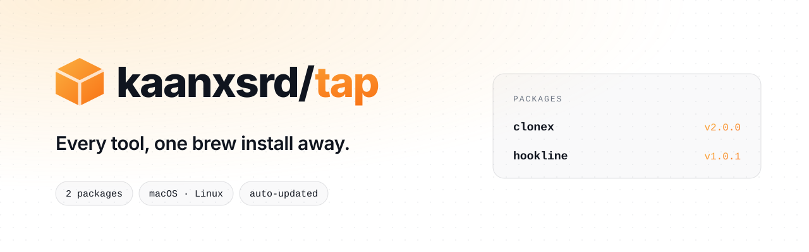
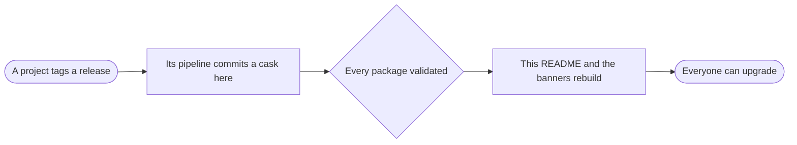

<!-- Generated by scripts/update_readme.py after every package change. Edit that script, not this file. -->
<div align="center">

<picture>
  <source media="(prefers-color-scheme: dark)" srcset="assets/banner-dark.svg">
  
</picture>

<br>

**Every command-line tool from Vante, installed and updated with [Homebrew](https://brew.sh).**

<br>

[](https://brew.sh)
[](#packages)
[](#packages)
[](#how-it-works)

**[Packages](#packages)** ·
**[Install](#install)** ·
**[Upgrade](#upgrade-and-uninstall)** ·
**[How it works](#how-it-works)** ·
**[Add a package](#add-a-package)**

</div>

<br>

## Packages

| Package | Version | Runs on | What it does | Install |
| --- | --- | --- | --- | --- |
| [**clonex**](https://github.com/kaanxsrd/CloneX) | `2.0.0` | macOS, Linux (x64, arm64) | Preview and copy the structure of a Discord server. | `brew install --cask kaanxsrd/tap/clonex` |
| [**disweep**](https://github.com/kaanxsrd/Disweep) | `1.0.0` | macOS (x64, arm64) | Sweep your Discord messages. Review it first. | `brew install --cask kaanxsrd/tap/disweep` |
| [**hookline**](https://github.com/kaanxsrd/hookline) | `1.0.1` | macOS, Linux (x64, arm64) | Catch every webhook. Replay anything. Pipe it to localhost. | `brew install --cask kaanxsrd/tap/hookline` |

## Install

```sh
brew install --cask kaanxsrd/tap/<package>
```

Homebrew adds this tap by itself the first time, so there is no separate `brew tap` step.

## Upgrade and uninstall

```sh
brew update && brew upgrade --cask <package>
brew uninstall --cask <package>
brew untap kaanxsrd/tap   # optional: remove this tap
```

## How it works



Each project's release pipeline publishes its own builds and commits the result here, with the download URLs and SHA-256 checksums of that release. GitHub Actions then checks every package and rebuilds this page, so the list above is always what the repository really contains.

## Add a package

Have the project's release pipeline commit one file: `Casks/<package>.rb` for a binary, or `Formula/<package>.rb` for a formula. It needs a `desc`, `homepage`, `url` and `sha256`, and the file name must match the package name.

That is the only step. The package appears above after the next push, with its version and platforms read from that file. A malformed package fails the [workflow](.github/workflows/update-readme.yml) and leaves this page unchanged.

<details>
<summary><b>Publishing from a release pipeline</b></summary>

<br>

The pipeline needs a token with **Contents: read and write** on this repository. To publish under your own account rather than a bot, commit with your GitHub no-reply address:

```sh
git config user.name "$GITHUB_REPOSITORY_OWNER"
git config user.email "${GITHUB_REPOSITORY_OWNER_ID}+${GITHUB_REPOSITORY_OWNER}@users.noreply.github.com"
```

With GoReleaser, set the same identity under `commit_author`.

</details>

<div align="center">
<br>
<sub>Generated automatically. Please don't edit package files by hand: the next release replaces them.</sub>
</div>
